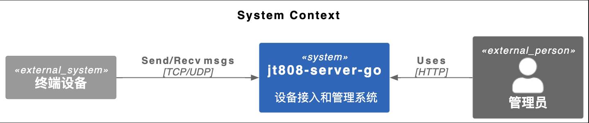
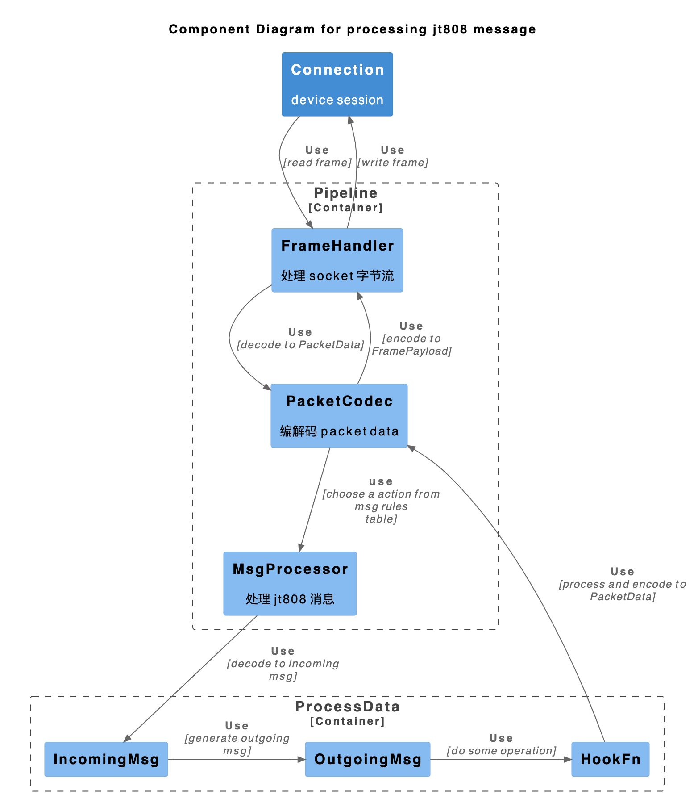
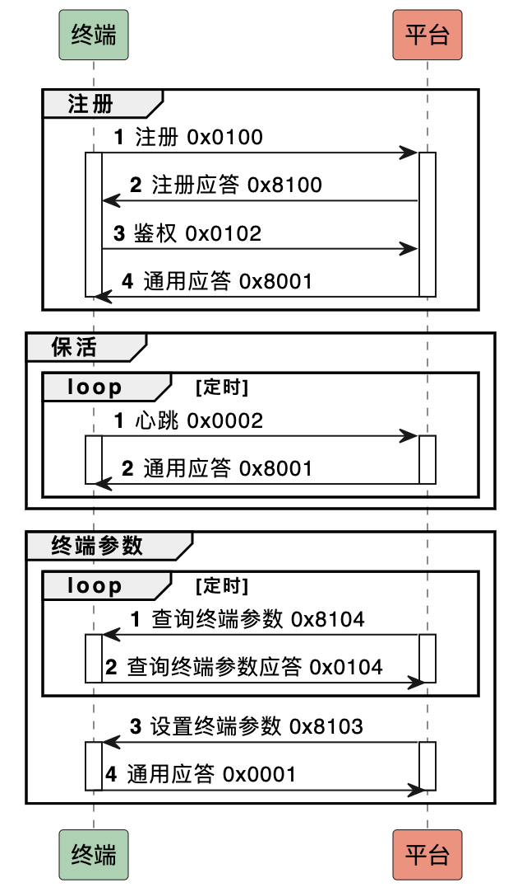
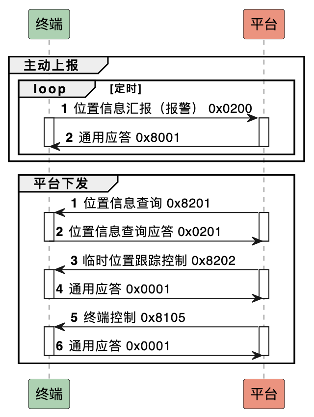

# jt808-server-go

> **JT/T 808 终端接入服务。一套协议内核，支持单机 Standalone 和 Cluster 模式运行。**
>
> 支持 JT/T 808-2011/2013/2019 三个版本，并覆盖苏标主动安全（T/JSATL 12）与 JT/T 1078 音视频信令。单进程启动即可完成注册鉴权、位置与报警上报、主动安全附件接收、1078 码流接入；业务数据可落 memory、SQLite 或 MySQL。协议字段与字节序逐条对照标准实现，下行命令具备 outbox 重投，上行落库与应答时机按消息分类可配。接入量增长后，接入层与业务层可按配置拆成独立服务，内核不变。

当前能力概览：

- 终端通过 TCP 或 UDP 接入，完成注册、鉴权、心跳与位置/报警等上报；
- 业务数据可按配置写入 `memory`、SQLite 或 MySQL，运行时状态与会话保持在进程内；
- 提供业务 HTTP API 下发命令、查询设备与历史，另提供独立管理面；
- 支持苏标主动安全附件接收、JT/T 1078 信令与 UDP/H.264 码流接入；
- 下行命令具备 outbox 重投，上行落库与应答时机可按消息分类配置；
- 默认以单进程部署，协议内核、消息模型与仓储接口不绑定部署形态。

## 1. 快速开始

前置条件：Go 1.26+，`make` 与 `bash`。默认配置不需要数据库。

```sh
# 编译到 target/debug/jt808-server-go
make compile

# 使用 configs/default.yaml 启动
make run
```

不传 `-c` 时使用编译进二进制的内嵌默认配置（`memory` 后端）；`-c <file>` 才读取 YAML 文件：

```sh
./target/debug/jt808-server-go                        # 内嵌默认配置
./target/debug/jt808-server-go -c configs/default.yaml
```

默认监听：

| 用途 | 配置键 | 默认值 |
|---|---|---|
| 终端 TCP 接入 | `server.port.tcpPort` | `8080` |
| 终端 UDP 接入 | `server.port.udpPort` | `8081`，置空可关闭 |
| 业务 HTTP API | `server.port.httpPort` | `8008` |
| 苏标附件服务器 | `alarmServer.port` / `alarmServer.udpPort` | `7200` / `7201` |
| 管理面 | `admin.addr` | `127.0.0.1:9000`，默认不启动 |
| 1078 RTP 接入 | `mediaServer.port` | 空，默认不启动 |

另开一个终端启动自带的模拟终端，验证注册、鉴权、心跳和位置上报：

```sh
make run-client

# 查询已注册设备（默认 api.auth.token 为空，鉴权关闭）
curl -s http://localhost:8008/api/device
```

默认配置下 `storage.type: memory`，重启后业务数据丢失；附件服务器默认开启，媒体服务与管理面默认关闭，业务 API 鉴权默认关闭。

## 2. 协议支持范围

### 2.1 JT/T 808

消息头只能区分 2019 与非 2019。2011 与 2013 无法从消息头区分，当前仅在 `0x0100` 终端注册消息中按消息体剩余长度做启发式判别；注册/鉴权/终端属性等消息体再按版本使用不同字段宽度。

| 区别点 | 2011 | 2013 | 2019 |
|---|---|---|---|
| 终端制造商编码长度 | 5 字节 | 5 字节 | 11 字节 |
| 终端型号编码长度 | 8 字节 | 20 字节 | 30 字节 |
| 终端 ID 编码长度 | 7 字节 | 7 字节 | 30 字节 |
| 从业资格证编码长度 | 40 字节 | 20 字节 | 20 字节 |

注册表当前覆盖 **81 个不同 MsgID、42 个处理函数**（以 `internal/protocol/msg_processor.go` 为准）。注册表同时包含三类语义，不能按 MsgID 数值简单区分：

- 服务端上行处理，如 `0x0002`、`0x0200`、`0x0704`、`0x1205`；
- 平台下行命令与应答，如 `0x8100`、`0x8104`、`0x8202`、`0x8802`；
- 模拟器侧行为，如 `0x8104` 生成假参数、`0x8700` 生成记录仪应答。

消息族覆盖注册鉴权、心跳/注销、定位与报警、参数与属性、文本/事件/提问、电话回拨/电话本、车辆控制、区域与路线、记录仪（GB/T 19056）、司机身份/CAN/运单、多媒体事件/上传/检索/资源列表、透传与压缩上报、1078 信令、苏标附件信令等。其中部分消息只有模型与应答、业务尚未闭环，逐条实现状态以 `internal/protocol/msg_processor.go` 的注册项和 `internal/protocol/model/` 下的消息体为准。

### 2.2 JT/T 1078

808 多媒体信令（`0x0800/0x0801/0x8802/0x0802/0x8803`）在实际使用中只承载图片：音视频会长时间占用主连接，阻塞其他指令。因此实时音视频与录像回放被拆到 1078，由独立信令与 RTP 码流承担，两套协议不是重复实现。

已实现以下 9 条信令的编解码与处理：

`0x9101`、`0x9102`、`0x9105`、`0x9201`、`0x9202`、`0x9205`、`0x9206`、`0x1205`、`0x1206`

`0x1205` 资源列表与 `0x1206/0x9206` 媒体元数据支持持久化。配置 `mediaServer.port` 后启用独立 UDP 端口接收 RTP 码流，当前实现范围：

- 仅 UDP，不支持 `0x9101` 的 TCP 推送；
- 仅 H.264，不支持 H.265、音频和透传数据；
- 把 PS/ES 还原为 Annex B 裸流并落成 `.h264` 文件，目录结构为 `<dir>/<手机号>/channel_<通道号>/<时间戳>.h264`；
- 不做转码、分发、播放器索引，也不提供回放服务。

平台侧没有发起实时传输或回放的业务 API，`0x9101/0x9102/0x9201/0x9202/0x9206` 目前只有消息模型与通用应答。

### 2.3 苏标主动安全

实现 `0x1210/0x1211/0x1212` 报警附件信令、`0x9208` 报警附件上传指令与 `0x9212`，以及附件服务器的 `0x30 0x31 0x63 0x64` 文件码流帧。附件服务器 TCP 与 UDP 共用同一套组装逻辑，落盘目录为 `<dir>/<手机号>/<YYYYMMDD>/<报警编号>/<文件名>`。

附件服务器默认启用。`alarmServer.autoUpload` 为 `false` 时仅通过业务 API 手动下发 `0x9208`；开启后需配置 `alarmServer.uploadIP`，`0x9208` 通告的端口直接取自 `alarmServer.port` 与 `alarmServer.udpPort` 的实际监听值，未配置的一侧通告为 `0`。

## 3. 整体架构



协议接入、消息处理、业务落库、下行命令与运维接口默认在同一个进程内协作：

```text
终端 ──TCP/UDP──> internal/server ──> internal/protocol/pipeline ──> msg_processor
                                                                    │
                          ┌─────────────────────────────────────────┤
                          ▼                                         ▼
                 repository / storage                    uplink.reliability
                 （memory | sqlite | mysql）              （先应答还是先落库）
                          ▲
                          │
业务 API / 管理面 ──> server.Send / command outbox ──> 终端
```

### 3.1 一条消息怎么走完 Pipeline



TCP 与 UDP 复用同一条 `Pipeline`，每个会话一个协程串行处理：

1. `FrameHandler` 从 socket 读取字节流，去转义、校验并得到完整帧 `FramePayload`；
2. `PacketCodec` 把 `FramePayload` 解码为 `PacketData`（消息头 + 消息体）；
3. `MsgProcessor` 按 MsgID 查注册表，选择解码模型与处理函数，分包未完成时先走分包缓存；
4. 处理函数执行解码、业务处理（落库/缓存/查询投递）并生成应答消息；
5. `PacketCodec` 把待发送消息编码回 `PacketData` 与 `FramePayload`；
6. `FrameHandler` 写回连接，完成一次请求/应答。

业务处理与写回应答在同一个会话协程内执行，因此落库耗时会直接体现在应答时延上——这正是第 8 节按消息分类选择“先应答”还是“先落库”的原因。

### 3.2 包职责

| 包/目录 | 职责 |
|---|---|
| `cmd/jt808-server` | 主服务启动、组件装配、信号处理与优雅关机 |
| `cmd/jt808-client` | JT808 终端模拟器入口 |
| `cmd/jt808-migrate` | 独立数据库迁移工具 |
| `internal/protocol` | 帧处理、编解码、Pipeline、消息注册表与业务处理 |
| `internal/protocol/model` | 各 MsgID 的消息结构、终端与消息头定义、会话与分包 |
| `internal/codec` | hex、GBK、哈希、行政区划等编解码 |
| `internal/server` | TCP/UDP 监听、会话生命周期、下行应答与重传 |
| `internal/runtime` | 进程内运行时状态：连接注册表、心跳、跟踪、查询应答协调 |
| `internal/repository` | 持久化仓储接口；`sqlstore` 为 SQLite/MySQL 实现 |
| `internal/repository/migration` | 版本化 SQL 迁移文件 |
| `internal/storage` | 存储后端装配，聚合为 `Stores` |
| `internal/uplink` | 上行可靠性分类与 `best_effort` / `at_least_once` 策略 |
| `internal/command` | 下行命令 outbox 重投循环 |
| `internal/alarmserver` | 苏标附件服务器（TCP/UDP、文件组装、保留期清理） |
| `internal/media` | 1078 RTP UDP 接收、PS 解复用、H.264 落盘 |
| `internal/api` | 业务 HTTP API（`/api`） |
| `internal/adminapi` | 独立管理面、探针、指标与会话运维 |
| `internal/observability` | 健康检查、就绪检查、Prometheus 文本指标 |
| `internal/httpguard` | 业务 API 鉴权、按来源 IP 限流、操作审计 |
| `internal/action` | 消息处理生命周期 Hook 与 HTTP 回调实现 |
| `internal/config` | YAML 配置加载、内嵌默认值与校验 |
| `client/` | 模拟器配置与数据生成 |

### 3.3 存储分层

- **持久化仓储**：设备档案、参数、属性、报警、区域、行业目录、媒体元数据、命令 outbox、定位历史可按后端落库；SQL 后端覆盖上述仓储。
- **运行时状态**：会话、心跳、临时跟踪、查询应答协调只存在进程内，重启自然归零，不入库。最新定位投影 `Geo` 也始终在进程内；SQL 后端只持久化定位历史。

### 3.4 连接建立、保活与断连

协议口径：

- **建立**：终端复位后尽快与平台建立 TCP 或 UDP 连接，连接建立后立即发送 `0x0102` 鉴权。
- **维持**：鉴权成功后，在没有正常数据包传输时，终端按参数指定周期发送 `0x0002` 心跳，平台回 `0x8001`。
- **断开**：平台和终端都可主动断开。平台侧的判定依据是 TCP 断开、相同身份的新连接顶替旧连接、或超过保活时间未收到任何消息；终端侧依据是链路断开、平台主动断开，或达到重传次数仍未收到应答。

实现上，每个会话注册一个保活检查任务，按设备保活间隔检查最近通信时间：超时未收到消息则标记离线；离线后再次到期则关闭连接并清理运行时缓存。SQL 后端只用进程内连接与最近心跳判定在线，**不会删除设备静态档案**。同一手机号建立新连接时，旧会话被顶替。

## 4. 典型交互时序

设备管理：注册 → 注册应答 → 鉴权 → 心跳保活 → 参数查询/设置。



位置与报警：终端主动上报定位/报警，平台回 `0x8001`；平台可主动查询位置或设置临时跟踪。



## 5. 构建、运行与验证

### 5.1 构建

```sh
# 本地调试二进制：target/debug/jt808-server-go，并复制 configs/
make compile

# 交叉编译 darwin/linux amd64+arm64：target/release/jt808-server-go 与 jt808-migrate
make release

# 模拟器与管理工具
make compile-client      # target/debug/jt808-client-go
make release-client      # target/release/jt808-client-go（四个平台产物）
make compile-migrate     # target/debug/jt808-migrate
```

### 5.2 启动

```sh
make run
# 等价于 go run cmd/jt808-server/main.go -c configs/default.yaml

./target/debug/jt808-server-go -c configs/default.yaml
```

启动横幅可通过 `server.banner.bannerPath` 指向的文件自定义，默认 `configs/banner.txt`；`server.banner.enable: false` 可关闭。

### 5.3 测试与端到端冒烟

```sh
# 单元测试 + race + 覆盖率，产出 target/test/
make test

# 构建真实 server/client 二进制并跑 5 个端到端场景
make smoke
```

`make smoke` 覆盖：注册→鉴权→注销、全量上行消息、常驻终端心跳/定位、分包乱序与 `0x8003` 补传、异常帧拒绝后继续处理正常帧。可用 `SMOKE_TCP_PORT` / `SMOKE_UDP_PORT` / `SMOKE_HTTP_PORT` 覆盖端口，`--keep-logs` 保留日志。

模拟器还可用于故障注入与分包测试：

```sh
# 注册消息按 16 字节分包、逆序发送、丢弃第 2 片
./target/debug/jt808-client-go -c client/configs/default.yaml \
  -fragment-size 16 -reverse-fragments -drop-fragment 2

# 注册前先发异常帧：bad-checksum / bad-escape / oversize
./target/debug/jt808-client-go -c client/configs/default.yaml \
  -fault-frame bad-escape
```

模拟器默认走 TCP。验证 UDP 接入时，修改 `client/configs/default.yaml`：

```yaml
device:
  transProto: "UDP"
```

### 5.4 数据库迁移

SQLite 与 MySQL 都不在服务启动时自动执行迁移。首次部署或升级后先运行独立工具：

```sh
# 先在 configs/default.yaml 中设置 storage.type 与连接参数
make compile-migrate
./target/debug/jt808-migrate -c configs/default.yaml

# 然后再启动主服务
make run
```

迁移文件位于 `internal/repository/migration/`，按 `<日期>_<描述>.sql` 命名。主服务启动只校验 `schema_migrations` 版本：版本落后会提示先执行 `jt808-migrate`，版本超前会拒绝启动。MySQL 场景也可以由 DBA 按文件名顺序直接执行这些 SQL。

### 5.5 Docker 部署

```sh
make dockerbuild

docker compose -f deploy/docker-compose.yml up --build
```

镜像入口为 `/app/output/jt808-server-go -c /app/output/configs/default.yaml`，同时包含 `/app/output/jt808-migrate`。compose 映射 `8080`、`8081/udp`、`8008`、`7200`、`7201/udp`，挂载只读配置与 `data`/`logs` 卷。管理面默认只监听容器内 `127.0.0.1:9000`，不发布到宿主机；compose 的 healthcheck 依赖 `/healthz`，因此需要先在配置中开启 `admin` 并配置非空 token，否则容器会一直处于不健康状态。

## 6. 关键配置项

配置文件默认为 `configs/default.yaml`，完整注释见该文件。

| 配置键 | 默认 | 说明 |
|---|---|---|
| `storage.type` | `memory` | `memory` / `sqlite` / `mysql`；空值等价 `memory` |
| `storage.sqlite.path` | `./data/jt808.db` | `sqlite` 后端库文件 |
| `storage.mysql.dsn` | 空 | `mysql` 后端 DSN，如 `user:pass@tcp(host:port)/db` |
| `server.ackTimeoutMs` | `5000` | 下行命令等待应答的超时 |
| `server.maxRetransmissions` | `3` | 下行命令最多重传次数 |
| `server.action.http.url` | 空 | 业务 Hook HTTP 回调地址；空则不启用 |
| `server.action.http.timeoutMs` | `2000` | Hook 回调超时 |
| `server.banner.enable` / `bannerPath` | `true` / `configs/banner.txt` | 启动横幅 |
| `api.auth.token` | 空 | 业务 API Bearer token；空表示关闭鉴权，生产必须配置 |
| `api.rateLimit.ratePerSecond` / `burst` | `50` / `100` | 业务 API 按来源 IP 的令牌桶 |
| `admin.enable` | `false` | 是否启动独立管理面 |
| `admin.addr` / `token` | `127.0.0.1:9000` / 空 | 管理面监听地址；开启时 token 必填 |
| `admin.rateLimit.ratePerSecond` / `burst` / `keyBy` | `10` / `20` / `credential` | 管理面令牌桶；`keyBy` 可为 `credential` 或 `source` |
| `alarmServer.port` / `udpPort` | `7200` / `7201` | 苏标附件 TCP / UDP 监听；两者都为空时整段不启动 |
| `alarmServer.dir` | `./data/alarms` | 附件落盘目录 |
| `alarmServer.maxFileSize` / `maxConcurrent` | `104857600` / `16` | 单附件上限与并发组装数 |
| `alarmServer.completedTTL` | `20m` | 已完成附件的内存状态保留时长 |
| `alarmServer.retentionDays` | `7` | 已完成附件文件保留天数；`0` 表示不清理 |
| `alarmServer.autoUpload` / `uploadIP` | `false` / 空 | 报警首次上报时是否自动下发 `0x9208` |
| `mediaServer.port` | 空 | 1078 RTP UDP 监听；空则不启动 |
| `mediaServer.dir` / `retentionDays` | `./data/media` / `7` | `.h264` 落盘目录与保留天数；`0` 表示不清理 |
| `retention.locations.retentionDays` / `maxPerDevice` | `7` / `10000` | 定位历史保留；仅 SQL 后端生效 |
| `retention.alarms.dedupWindowMs` / `confirmExpireMs` / `maxPerDevice` | `1800000` / `600000` / `1000` | 报警去重、确认关联与上限 |
| `commandOutbox.mode` | 按后端归一化 | `off` / `memory` / `durable`；见第 8 节 |
| `commandOutbox.pollInterval` / `batchSize` | `10s` / `50` | 重投轮询周期与批次 |
| `commandOutbox.maxAttempts` / `expireAfter` | `5` / `24h` | 总下发次数与过期兜底 |
| `commandOutbox.leaseDuration` / `initialWait` | `1m` / `1m` | 投递租约与首次等待窗口 |
| `commandOutbox.retryBase` / `retryMax` | `5s` / `5m` | 退避区间 |
| `uplink.reliability.*` | 见第 8 节 | 上行按分类选择 `best_effort` / `at_least_once` |
| `log.*` | 见默认配置 | 控制台/文件、级别、滚动大小与保留 |

`retention` 的示例值中，定位 7 天/10000 条为工程默认值（JT/T 808 未规定平台侧保存期限），报警 30 分钟去重、10 分钟确认关联、1000 条上限沿用既有内存实现。显式写 `0` 表示关闭对应策略。

一个切换到 SQLite 并开启鉴权、管理面的最小示例：

```yaml
storage:
  type: "sqlite"
  sqlite:
    path: "./data/jt808.db"

api:
  auth:
    token: "change-me"

admin:
  enable: true
  addr: "127.0.0.1:9000"
  token: "change-me"

uplink:
  reliability:
    default: "best_effort"
    location: "best_effort"
    batchLocation: "at_least_once"
    alarm: "at_least_once"

commandOutbox:
  mode: "durable"
```

## 7. 对外接口

### 7.1 监听端口

| 入口 | 默认地址 | 配置 | 说明 |
|---|---|---|---|
| 终端接入 TCP | `:8080` | `server.port.tcpPort` | 808/1078 信令主连接 |
| 终端接入 UDP | `:8081` | `server.port.udpPort` | 置空即关闭 |
| 业务 HTTP API | `:8008` | `server.port.httpPort` | `/api`，Token 鉴权 + 按 IP 限流 + 审计 |
| 管理面 | `127.0.0.1:9000` | `admin.addr` | 默认不启动；开启后要求 Bearer token |
| 苏标附件 TCP/UDP | `:7200` / `:7201/udp` | `alarmServer.port` / `udpPort` | 两者都为空时不启动 |
| 1078 RTP | 配置值 | `mediaServer.port` | 独立 UDP 端口，空则不启动 |

### 7.2 业务 API

公共前缀 `/api`。除查询类接口外，变更类请求会做鉴权与审计；下行接口在 outbox 开启时支持 `Idempotency-Key` 请求头，重复键返回已有命令记录而非二次下发。

| 方法 | 路径 | 用途 |
|---|---|---|
| GET | `/api/commands/:commandId` | 查询下行命令状态；outbox 关闭时返回 404 |
| GET | `/api/device` | 列出已注册设备 |
| GET | `/api/device/:phone/reports/:kind` | 查询行业上报最新快照；`kind` 为 `driver`、`can`、`recorder`、`media-event`、`media-capture`、`media-search`、`media-uploads`、`transparent`、`peripheral` |
| GET | `/api/device/:phone/geo` | 设备档案 + 最新定位 |
| GET | `/api/device/:phone/params` | 查询本地保存的终端参数 |
| GET | `/api/device/:phone/properties` | 查询本地保存的终端属性 |
| GET | `/api/device/:phone/location` | 实时查询位置：下发 `0x8201`，等待 `0x0201`，10 秒超时 |
| POST | `/api/device/:phone/control` | 终端控制 `0x8105` |
| POST | `/api/device/:phone/regions/delete` | 删除区域或路线 |
| POST | `/api/device/:phone/regions/set` | 设置区域或路线 |
| POST | `/api/device/:phone/regions/query` | 查询区域或路线 |
| POST | `/api/device/:phone/driver/query` | 司机身份查询 `0x8702` |
| POST | `/api/device/:phone/recorder/command` | 记录仪命令 `0x8700` / `0x8701` |
| POST | `/api/device/:phone/media/capture` | 摄像头立即拍摄 `0x8801` |
| POST | `/api/device/:phone/media/search` | 存储多媒体数据检索 `0x8802` |
| POST | `/api/device/:phone/media/resources` | 查询音视频资源列表 `0x9205` |
| POST | `/api/device/:phone/media/command` | 多媒体上传/录音控制 `0x8803` / `0x8804` / `0x8805` |
| POST | `/api/device/:phone/text/issue` | 文本信息下发 `0x8300` |
| POST | `/api/device/:phone/events/set` | 事件设置 `0x8301` |
| POST | `/api/device/:phone/vehicle/control` | 车辆控制 `0x8500` |
| POST | `/api/device/:phone/question/issue` | 提问下发 `0x8302` |
| POST | `/api/device/:phone/info/menu/set` | 信息菜单设置 `0x8303` |
| POST | `/api/device/:phone/info/service` | 信息服务 `0x8304` |
| POST | `/api/device/:phone/call/callback` | 电话回拨 `0x8400` |
| POST | `/api/device/:phone/phonebook/set` | 电话本设置 `0x8401` |
| POST | `/api/device/:phone/terminal/upgrade` | 终端升级 `0x8108` |
| POST | `/api/device/:phone/transparent/down` | 数据下行透传 `0x8900` |
| POST | `/api/device/:phone/alarms/confirm` | 人工确认报警 `0x8203` |
| GET | `/api/device/:phone/alarms` | 查询报警记录 |
| PUT | `/api/device/:phone/params` | 设置终端参数 `0x8103` |
| POST | `/api/device/:phone/attachments/upload` | 下发 `0x9208` 报警附件上传指令 |
| GET | `/api/device/:phone/attachments` | 列出已接收附件 |
| GET | `/api/device/:phone/attachments/:fileName` | 查询单个附件的元数据（不返回文件内容） |

请求体字段直接复用协议模型，字段级定义见 `internal/protocol/model/`；路由与参数校验见 `internal/api/api.go`。

### 7.3 调用示例

下发一条文本信息，返回 `202` 表示已受理并开始投递：

```sh
curl -s -X POST http://localhost:8008/api/device/13000000000/text/issue \
  -H 'Content-Type: application/json' \
  -H 'Idempotency-Key: demo-1' \
  -d '{"flag":0,"textType":1,"text":"hello"}'
```

```json
{
  "commandId": "0f8c2f6d9a1e4b7c8d3e5f60718293a4",
  "duplicate": false,
  "messageId": "0x8300"
}
```

查询命令最终状态（`pending` / `acked` / `failed`）：

```sh
curl -s http://localhost:8008/api/commands/0f8c2f6d9a1e4b7c8d3e5f60718293a4
```

```json
{
  "commandId": "0f8c2f6d9a1e4b7c8d3e5f60718293a4",
  "phone": "13000000000",
  "messageId": "0x8300",
  "serial": 12,
  "status": "acked",
  "attempts": 1
}
```

### 7.4 管理面

需 `admin.enable: true` 与 `admin.token`：

| 方法 | 路径 | 鉴权 | 说明 |
|---|---|---|---|
| GET | `/healthz` | 否 | 存活探针，恒返回 200 |
| GET | `/readyz` | 否 | 就绪探针，返回各检查项明细；失败返回 503 |
| GET | `/ping` | 是 | 管理面连通性检查 |
| GET | `/metrics` | 是 | Prometheus 文本格式指标 |
| GET | `/sessions` | 是 | 当前实例会话列表 |
| GET | `/sessions/:phone` | 是 | 当前实例会话详情 |
| DELETE | `/sessions/:phone` | 是 | 强制断开当前实例上的会话 |
| GET | `/locations` | 是 | 历史分页查询，必须带 `phone`、`from`、`to` |
| GET | `/alarms` | 是 | 历史分页查询，必须带 `phone`、`from`、`to` |

会话类接口只作用于当前进程，跨实例无效；`/locations`、`/alarms` 读取持久化历史（`memory` 后端下 `/locations` 不可用）。

### 7.5 Action Hook

`server.action.http.url` 用于把消息处理生命周期事件回调给第三方业务平台：注册、鉴权、定位、报警、断连五类事件以 JSON 异步 POST 到该地址，不阻塞协议处理。回调队列容量 256，队列满时丢弃事件；HTTP 失败只记日志，不重试，也不影响应答。关闭时留空即可。

## 8. 上行与下行可靠性语义

### 8.1 上行：应答时机决定投递语义

JT/T 808 的上行重传由终端负责：终端收到对应应答（通常为 `0x8001`）才停止重传，收不到就继续重传。因此平台发送应答的时机直接决定投递语义。配置段为 `uplink.reliability`：

| 分类 | 配置键 | 默认 | 行为 |
|---|---|---|---|
| `default` | `uplink.reliability.default` | `best_effort` | 其余消息 |
| `location` | `uplink.reliability.location` | `best_effort` | `0x0200` 且报警标志位为 0 |
| `batch_location` | `uplink.reliability.batchLocation` | `at_least_once` | `0x0704` 批量定位 |
| `alarm` | `uplink.reliability.alarm` | `at_least_once` | `0x0200` 且报警标志位非 0 |

- `best_effort`：先应答后落库；落库失败只记日志，不等终端重传。语义为 **at-most-once**，可能丢一条。
- `at_least_once`：先完成落库，成功后才应答；落库失败则本次不应答，终端按协议重传，从而获得 **at-least-once**。可能重复落库。

上述策略只作用于“应答内容固定、业务结果不参与应答”的上行消息（如 `0x0200`、`0x0704`、`0x0801`）。注册、鉴权、查询应答等需要业务结果决定应答内容的消息始终先执行业务再应答。`0x0801` 的应答是 `0x8800`，`0x1210/0x1211` 固定为 `0x0001`，其余通用应答为 `0x8001`。

实现不引入本地文件队列、spool 或后台补偿线程；落库动作仍由存储层承担（`memory` 后端只在进程内，重启仍会丢失）。

### 8.2 下行：会话重传 + outbox 重投

- 单条命令下发后按 `(手机号, MsgID, 流水号)` 等待终端 `0x0001/0x8001`；超时后按 `server.ackTimeoutMs` 重传，最多 `server.maxRetransmissions` 次，耗尽后计入 `jt808_ack_timeouts_total`。
- `commandOutbox.mode` 控制下行命令是否落 outbox：
  - `off`：直接下发，不落库、不可查、不可重投；
  - `memory`：保留幂等与状态查询，重启即丢；
  - `durable`：写入 SQL 表，重启后仍可重投。

  未显式配置时按存储后端归一化：`memory` 后端默认 `memory`，SQL 后端默认 `durable`。
- 重投复用原始流水号，语义为 **at-least-once**：终端可能收到并执行重复命令，这是为保证应答能回填原 outbox 记录而接受的代价。
- 设备离线时 pending 命令保持等待，由租约与过期时间兜底；`maxAttempts` 达到上限或超过 `expireAfter` 后转 `failed`。
- 租约避免同一命令被多个实例同时占用，但会话本身是进程内状态，多实例下仍不具备跨节点投递语义。

## 9. 可观测性与运维

以下探针与指标都挂在独立管理面上，需先开启 `admin.enable` 并配置 `admin.token`（`/healthz`、`/readyz` 本身不校验 token）。

- `/healthz`：存活探针，不依赖存储或外部组件。
- `/readyz`：依次检查 `storage`（SQL Ping）、`outbox_backlog`（过期 pending 命令数，默认阈值 100）、`media_disk`、`attachment_disk`。未启用的组件不参与判定，避免把“功能关闭”误报成“服务异常”。
- `/metrics`：Prometheus 文本格式，当前指标：
  - `jt808_sessions_connected`
  - `jt808_ack_pending`
  - `jt808_ack_timeouts_total`
  - `jt808_outbox_pending`
  - `jt808_outbox_expired`
  - `jt808_media_streams`
  - `jt808_attachments_active`
  - `jt808_attachments_completed_total`
- 业务 API 的变更类请求（POST/PUT/PATCH/DELETE）与鉴权失败、限流拒绝会写入审计日志（zerolog），只记录方法、路径、来源 IP、状态码、手机号与耗时，不记录请求体与 token。
- 服务收到 `SIGINT`/`SIGTERM` 后按顺序优雅关机：停业务 API → 停终端接入并关闭会话 → 停 outbox 重投 → 刷盘媒体/附件 → 最后停管理面并关闭存储。

压测可用 `bash scripts/loadtest.sh [持续秒数]`（默认 60 秒、200 并发模拟终端、memory 后端），结束时从 `/metrics` 采集连接数、待应答数、应答超时与 outbox 指标。

数据备份按后端处理：SQLite 直接备份 `storage.sqlite.path` 指向的库文件；MySQL 使用常规逻辑或物理备份。附件与媒体目录独立于数据库，需要一并备份 `alarmServer.dir` 与 `mediaServer.dir`。

## 10. 已知边界与未实现项

以下为当前代码的真实边界，不要按“计划能力”理解：

| 领域 | 边界 |
|---|---|
| 808 版本 | 消息头无法区分 2011/2013，2011 仅在 `0x0100` 注册时按长度启发式识别；其余消息会按 2013 处理 |
| 808 消息 | 81 个 MsgID 包含服务端上行、平台下行与模拟器行为，并非全部已完整实现；部分消息只有模型与应答，业务未闭环 |
| 808 扩展 | 保留字段/厂商自定义扩展没有通用分发；2019 第 1 号修改单未做符合性评估 |
| 1078 | 仅 UDP、仅 H.264；TCP 推送、H.265、音频、转码、分发、播放器索引与回放服务均未实现；平台侧无发起实时传输/回放的 API |
| 苏标 | 附件可按手机号列出、按文件名查询元数据，没有文件内容下载接口；外设/透传的厂商扩展按原始或结构化模型处理，未做扩展分发；未实现粤标 `0x1FC4` |
| `memory` 后端 | 重启丢失全部业务数据；不保存定位历史（管理面 `/locations` 返回 503）；outbox 默认 `memory`，重启丢失 pending 命令；`retention` 配置不生效 |
| 定位投影 | 最新定位 `Geo` 始终在进程内，SQL 后端重启后需等下一次上报才恢复；SQL 只持久化定位历史 |
| 行业媒体快照 | `0x0801/0x0802/0x0805` 等媒体快照只在内存；`0x1205/0x1206/0x9206` 才落库 |
| 集群与分布式 | 会话、心跳、跟踪与查询应答协调均为进程内状态；当前代码未实现多实例共享会话路由、跨节点下行投递、MQ Sink、Redis/Kafka 等分布式能力 |
| 升级工作流 | 只有 `0x8108` 下发与 `0x0108` 结果记录；没有升级包托管/下载 URL、版本与车型管理、灰度发布、失败重试与回滚 |
| 投递保证 | 下行 outbox 为 at-least-once，可能重复执行；上行 `best_effort` 可能丢一条，`at_least_once` 依赖终端重传，不是 exactly-once |
| 安全 | 业务 API 鉴权可关闭；TCP/UDP 接入与所有 HTTP 接口均未提供 TLS；管理面默认关闭，开启后要求 token |
| 形态 | 仓库不含前端控制台；可插拔上行 Sink（`local-db` / `noop` / 未来 `mq`）仍为设计概念，代码中只有按分类选择应答时机的 `uplink.Policy`，尚未落地出口配置段 |
| Action Hook | 回调是尽力而为：异步队列满即丢弃，HTTP 失败只记日志，不重试、不保证送达 |

## License

[MIT](LICENSE)
