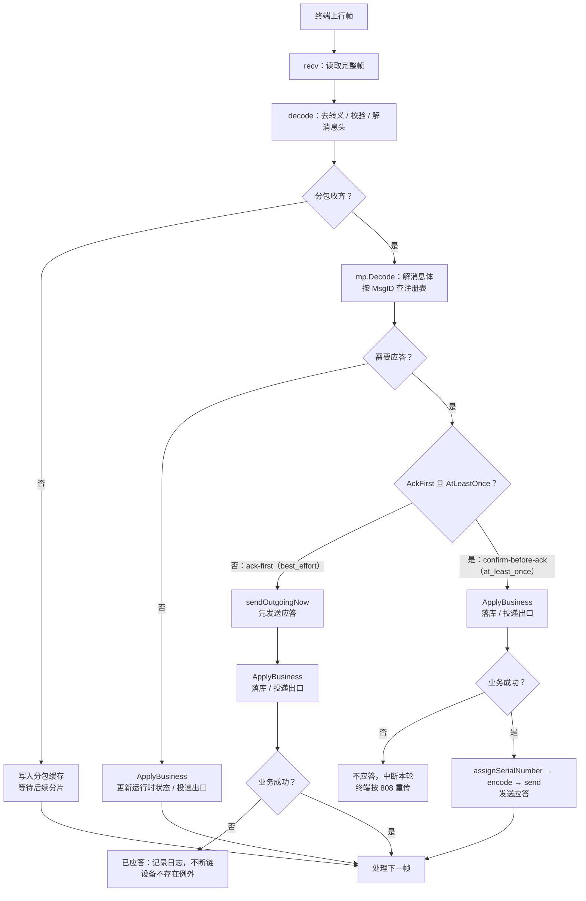
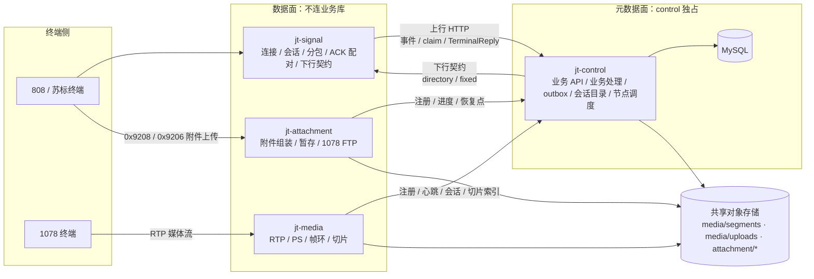
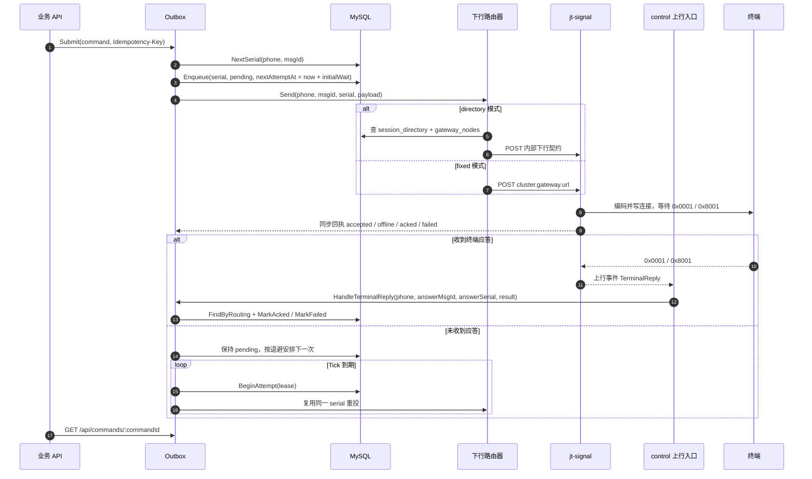
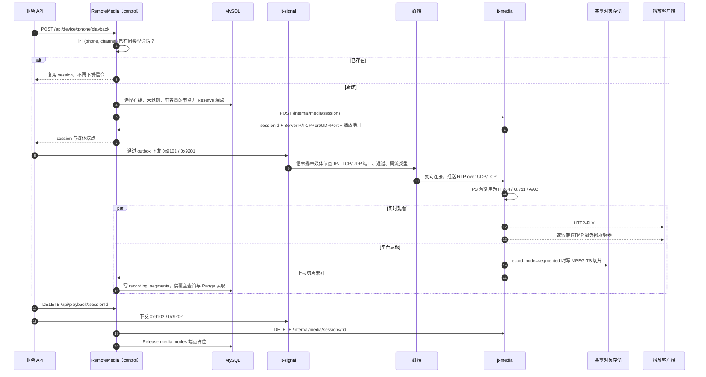

# 架构与集群模式

本文说明消息如何流转、各模块负责什么，以及 Standalone 与 Cluster 两种形态下状态归谁所有。协议逐条状态见[协议覆盖](protocol-coverage.md)，部署步骤见[安装与部署](installation.md)。

## 1. 分层与消息流转

系统按“接入、协议、业务、元数据、投递、运维”分界，而不是按代码目录分界。三件事的变化频率不同：连接与并发模型随部署规模变化，编解码与版本差异随协议标准变化，业务落库与查询随产品需求变化。把三者隔开，才能在增加接入量时不改协议、换元数据后端时不改业务、补版本差异时不碰网络层。

TCP 与 UDP 复用同一条 Pipeline，每个会话一个协程串行处理：

1. 接入层从 socket 读取字节流，去转义、校验并得到完整帧；
2. 协议层解码消息头与消息体，按 MsgID 查注册表；分包未完成时先走分包缓存；
3. 业务处理执行落库/缓存/查询投递，并生成应答；
4. 协议层把待发送消息编码回帧；
5. 接入层写回连接，完成一次请求/应答。

分叉点在 `process()`：

- `best_effort`（ack-first）：先 `sendOutgoingNow` 应答，再 `ApplyBusiness`；落库失败只记日志，连接继续，语义为 at-most-once。
- `at_least_once`（confirm-before-ack）：先 `ApplyBusiness`，成功后才走 `assignSerialNumber → encode → send`；失败则不应答并中断本轮，终端按 808 重传，语义为 at-least-once。
- 无应答的消息仍执行 `ApplyBusiness`，用于更新应答登记、运行时状态与生命周期 Hook。

业务处理与写回应答在同一个会话协程内执行，因此落库耗时会直接体现在应答时延上。这正是上行可靠性按消息分类选择“先应答”还是“先落库”的原因。

集群网关的 `ApplyBusiness` 还会按消息归属分流：`OwnerGateway` 在本进程处理，`OwnerBoth` 先跑协议半边再投递，`OwnerControl` 只投递。`UplinkSink.Deliver` 对 `best_effort` 进入有界队列，对 `at_least_once` 同步等待 control 确认。

## 2. 模块职责

| 模块 | 职责 | 不负责 |
|---|---|---|
| 终端接入 | TCP/UDP 监听、会话生命周期、保活判定、下行写回与会话内重传 | 不解析业务字段，不决定落库 |
| 协议内核 | 消息头/消息体编解码、版本判别、分包重组、MsgID 注册与分发 | 不持有连接，不直接写数据库 |
| 业务处理 | 消息语义、行业数据缓存、查询应答协调、生成应答内容 | 不关心 socket 与帧格式 |
| 下行投递 | outbox 落库、幂等、租约、退避、过期与重投 | 不建立终端连接，不编码协议帧 |
| 元数据 | 仓储接口与 `memory`/SQLite/MySQL 实现、迁移版本校验 | 不理解协议消息与应答语义 |
| 对象存储 | S3 兼容 `ObjectStore` 与 `SharedVolume` 两种 BlobStore | 不感知业务语义 |
| 附件服务 | 苏标附件 TCP/UDP 组装、暂存、切片上传、进度上报、1078 FTP | 不参与 808 主连接会话管理 |
| 媒体服务 | 1078 RTP 接收、PS 解复用、H.264/音频输出、帧环、FLV/RTMP、录像切片 | 不做转码，不内置 RTMP 服务器 |
| 业务 API | 设备/历史查询、下行命令入口、媒体/附件/播放接口 | 不直接操作数据库，不持有协议会话 |
| 管理面 | 探针、指标、会话运维、历史分页 | 不参与终端协议处理链路 |
| 生命周期 Hook | 把注册、鉴权、定位、报警、断连事件异步通知第三方 | 不保证送达，不阻塞协议处理 |

## 3. 两种部署形态

### 3.1 Standalone

接入、协议、业务、元数据、附件、媒体与 API 都在一个进程内协作，启动即用。默认 `memory` 后端，零外部依赖；也可以切换 SQLite/MySQL 获得持久化。

### 3.2 Cluster

按角色拆成独立进程，协议内核不变。拆分的关键不是进程数量，而是状态归属。

数据面节点没有指向 MySQL 的边：它们只持有本地连接、媒体流与附件暂存，通过内部 HTTP 与 control 交互，并把文件写入共享存储。control 是唯一的元数据写者。

| 状态 | 归属 | 说明 |
|---|---|---|
| 连接、会话、心跳、最近通信时间 | 网关进程内存 | 节点本地；不落库 |
| 分包缓存、ACK 配对、会话内重传 | 网关进程内存 | 同一终端的分片应落到同一网关 |
| 查询应答协调 | 网关进程内存 | 下行请求需路由到持有会话的网关 |
| 设备档案、参数、属性、报警、定位历史 | control + 共享 MySQL | 数据面通过 HTTP 读写，不直连库 |
| 会话目录、generation | control 的 `session_directory` | `0x0102` claim 时写入，网关 release/过期时失效 |
| 网关节点注册与心跳 | control 的 `gateway_nodes` | 10 秒心跳，30 秒判死 |
| 下行命令 outbox | control + 共享 MySQL | 租约、退避、过期、重投都由 control 负责 |
| 媒体节点注册、端点占用 | control 的 `media_nodes` | 媒体节点注册/心跳，control 独占写入并分配端点 |
| 播放会话、帧环、录像切片 | 媒体节点内存 + 共享对象存储 | 切片索引由 control 落库 |
| 附件暂存、切片进度 | 附件节点本地暂存 + 共享对象存储 | 任务与终态由 control 落库 |
| 附件/媒体/图片文件 | 共享卷或 S3 兼容对象存储 | 所有角色必须指向同一套存储 |

#### 角色二进制

| 二进制 | 角色 | 主要职责 |
|---|---|---|
| `jt-signal` | gateway | 808 接入、协议、上行 HTTP 投递、下行契约服务端 |
| `jt-control` | control | 业务 API、落库、outbox、会话目录、媒体/附件调度、保留期清理 |
| `jt-media` | media | 1078 数据面、播放会话、录像切片与对象写入 |
| `jt-attachment` | attachment | 附件 TCP/UDP、暂存、对象切片、进度上报、1078 FTP |
| `jt-server-standalone` | 全部 | 单进程运行，配置中出现 cluster 角色时启动失败 |

`jt808-server` 是通用入口，按配置决定形态，适合本机调试。

## 4. 集群关键流程

### 4.1 注册鉴权与会话归属

1. 终端 `0x0100` 注册、`0x0102` 鉴权到达网关；
2. 网关通过 control 的只读设备档案接口查询注册信息；`0x0102` 时同步 claim 会话归属；
3. control 写入 `session_directory`，返回 generation；claim 失败时网关 fail-closed，不应答；
4. 上行事件信封携带 `gatewayId` 与 generation；旧 generation 的事件被丢弃并返回 `fenced`，网关收到后关闭本地会话；
5. 网关重启换实例时，注册会清理同 `gatewayId` 的旧实例目录行，旧会话不再被路由。

网关只缓存设备档案用于鉴权与信令判断。缓存新鲜时直接命中；缓存过期且 control 不可达时，在 `uplink.http.authGraceMs` 宽限期内继续按缓存放行；从未查到过档案的终端始终拒绝。

### 4.2 上行

网关把上行事件投递到 control 的 `/internal/v1/uplink`：

- `best_effort`：进入有界队列，队列满即丢弃并计数；适合实时定位等可由下一条覆盖的数据；
- `at_least_once`：同步等待 control 确认后再向终端应答；control 失败则不应答，由终端按 808 协议重传。

control 按 eventId 去重，去重窗口由 `cluster.uplink.dedupTTL` 控制。事件体的解码上限分别由 `maxBodyBytes`、`maxRequestBytes`、`maxDecodedBodyBytes` 约束。

### 4.3 下行

业务 API 把命令写入 outbox，由 control 的路由器投递：

- `fixed`：固定发往 `cluster.gateway.url`，只适用于单网关；
- `directory`：按 phone 查 `session_directory`，联表 `gateway_nodes` 定位归属网关；找不到、节点离线或 `sessionId` 不匹配时返回 `offline`，由 outbox 重试，不跨节点猜测。

网关收到下行请求后按幂等键去重，分配流水号并写入终端连接。命令状态通过终端 `0x0001/0x8001` 回填 outbox。

流水号在落库模式下由 control 在 `Submit` 时统一分配，确保 `(phone, msgId, serial)` 在首次下发前就确定；`commandOutbox.mode=off` 时不落库、不重投，由网关发送时分配流水号。`memory` 模式重启会丢 pending 命令。同步回执已经是 `acked` 时，后续同一应答的上行 `TerminalReply` 会被幂等忽略。

### 4.4 1078 媒体

1. control 在在线、未过期、容量未满的媒体节点中按负载选点，原子占位端点；
2. control 通过下行契约向终端发送 `0x9101`（实时）或 `0x9201`（终端回放）；
3. 终端按信令中的地址另开连接，向媒体节点推送 RTP；
4. 媒体节点解复用并输出 H.264/音频，实时流进入内存帧环，供 HTTP-FLV 播放或 RTMP 转推；
5. `record.mode=segmented` 时按周期切 MPEG-TS 并写对象存储，切片索引上报 control；业务 API 可按时间查询覆盖区间并按 `Range` 读取切片。

同一 `(phone, channel)` 已有同类型会话时复用，不重复下发信令。媒体节点掉线或过期不迁移既有流，终端重连后由新分配接管。

回放与录像的位置关系：`0x9201` 只负责让终端把历史码流推到媒体节点；平台录像不是回放请求的副产物，而由 `record.mode=segmented` 独立决定。无论实时流还是回放流，媒体节点都在解复用后把切片写入对象存储，control 只维护可重建的切片索引。

### 4.5 苏标附件与 1078 FTP

1. control 选择附件节点，下发 `0x9208`（苏标附件）或 `0x9206`（FTP 上传）；
2. 终端向附件节点上传；节点写入本地暂存并切片上传共享对象存储；
3. 附件节点不连数据库，通过 `progressReport` 向 control 上报水位与终态；control 维护 `attachment_files`、FTP 任务与已用字节；
4. 节点重启后向 control 查询恢复点，或扫描对象存储重建索引；
5. 文件完成后可通过业务 API 查询元数据与下载内容。

1078 FTP 只接受 PASV/EPSV；控制面不可达时节点拒绝新的 FTP 登录（421），已建立连接继续传输。

### 4.6 对象存储布局

全集群只有一套 objectStore，key 前缀按来源分区：

| 前缀 | 内容 |
|---|---|
| `media/segments/` | 1078 录像切片 |
| `media/uploads/` | `0x0801` 图片 |
| `attachment/subia/` | 苏标附件 |
| `attachment/ftp1078/` | 1078 FTP 录像 |

过期标记、pending 回收与保留期清理都按前缀隔离，control 不删除边缘节点的本地暂存路径。

## 5. 可靠性语义

### 5.1 上行：应答时机决定语义

JT/T 808 的上行重传由终端负责：终端收到对应应答才停止重传。平台发送应答的时机直接决定投递语义。

| 分类 | 默认 | 行为 |
|---|---|---|
| `best_effort` | 普通定位 | 先应答后落库；落库失败只记日志；at-most-once |
| `at_least_once` | 批量定位、报警 | 先落库再应答；失败不应答，终端重传；at-least-once |

注册、鉴权、查询应答等需要业务结果决定应答内容的消息始终先执行业务再应答。该策略不引入本地文件队列或补偿线程。

### 5.2 下行：会话重传 + outbox 重投

- 会话内按 `(手机号, MsgID, 流水号)` 等待应答，超时按 `server.ackTimeoutMs` 重传，最多 `server.maxRetransmissions` 次；
- outbox 的 `off`/`memory`/`durable` 决定是否落库、是否可查询与重启后能否重投；
- 重投复用原始流水号，语义为 at-least-once，终端可能执行重复命令；
- 租约避免多实例同时占用同一命令，但会话本身是节点本地状态，跨节点投递依赖会话目录路由。

## 6. 失败与降级

| 场景 | 行为 |
|---|---|
| control 不可达（网关鉴权） | 缓存新鲜时命中；过期后在宽限期内按缓存放行；从未查到档案始终拒绝 |
| control 重启 | 目录、节点与 outbox 不丢；恢复后按 `directory` 模式继续路由 |
| 网关宕机/分区 | 30 秒后节点过期，其会话不可路由；下行返回 `offline`，outbox 按策略重试 |
| 同一 `gatewayId` 多实例 | 后注册者顶替前者并清理旧目录；部署侧应避免，否则归属周期性抖动 |
| 终端跨网关重连 | 新 `0x0102` 改写目录并递增 generation；旧网关收到 `fenced` 后关闭会话 |
| 媒体节点掉线 | 不迁移既有流；终端重连后重新分配 |
| 附件节点暂存到顶 | 拒绝新的文件登记，终端收到失败应答；不排队写满磁盘 |
| 附件节点到 control 不通 | 继续接收已建立连接，拒绝新的 FTP 登录 |
| 主机时钟漂移 | 租约与节点判死时间偏移；2 秒容差只能覆盖小偏差，部署必须启用 NTP |

## 7. 已知架构边界

- 不做多地域容灾、跨数据中心双活，也不实现对外 API 网关与负载均衡。
- `session_directory` 没有 per-phone TTL；会话有效性由节点在线状态推出。
- control 是元数据面的单写者；多 control 副本的业务一致性不在当前实现范围内。
- 媒体节点与附件节点不连业务库，所有元数据经 HTTP 交给 control。
- `objectStore` 是 S3 兼容实现；`sharedVolume` 只校验标记文件，不校验卷的真实隔离性。
- 1078 视频限 H.264，不做转码、H.265、内置分发或播放器页面。
- 具体消息的已实现/部分实现/缺失状态以[协议覆盖](protocol-coverage.md)为准。
